<div align="center">

# CampusConnect V3

**Campus operations, in one place.** Report and resolve incidents, book rooms with approvals and recurring schedules, discuss work with staff-only notes, and get live updates — with smart assistance that runs **fully offline**.

[](https://github.com/anshultripathi-dev/CampusConnectV3/actions/workflows/ci.yml)


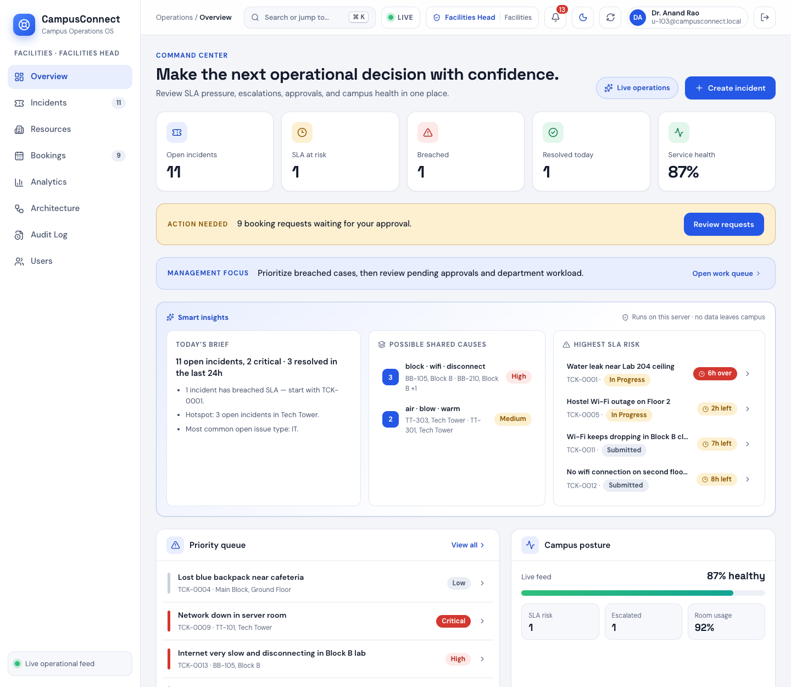

</div>

## Overview

CampusConnect is a **modular-monolith** web application for running a campus: students and staff report problems, the right team picks them up, rooms are booked through an approval workflow, and everyone sees what is happening in real time. It is also a working showcase of the **23 Gang-of-Four design patterns**, each used as a real part of a workflow rather than as an isolated example.

It runs as **one Node.js process with an embedded SQLite database** — no database server, no cloud services, and (apart from the optional Google button) **no internet required**.

> **V3** is the third generation of the project. See [how V1 → V2 → V3 evolved](#version-history) and the [migration guide](docs/MIGRATION.md).

## Highlights

| | |
|---|---|
| 🛠 **Incident management** | Guided reporting with photos, SLA tracking, a state-machine workflow with legal next steps only, hand-offs between departments, escalation, undo, audit trail, list and **Kanban** views |
| 💬 **Comments** | Conversations on every incident, plus **internal notes** that students never see |
| 📅 **Room bookings** | **Approval workflow** (Facilities Head / Supervisor / Admin), live availability, clash warnings, **recurring bookings** (daily, weekday, weekly, fortnightly) with series-wide decisions |
| 🧠 **Offline smart assistance** | Live triage suggestions, duplicate warnings, explainable SLA-risk scores, shared-cause clusters, a daily brief and **natural-language search** — no API key, nothing leaves the server |
| ⚡ **Real-time** | Socket.IO updates, **scoped** so people only receive what they may see |
| 🔐 **Secure by design** | Hashed passwords and session tokens, rate limiting, optional Google sign-in, role/department scoping everywhere, audited admin actions |
| 👥 **Administration** | Users & roles page, password change and reset |
| 🎨 **Polished UI** | Light/dark themes, command palette (`Ctrl/⌘+K`), analytics charts, responsive, WCAG-AA contrast |
| 🏗 **Architecture Observatory** | Browse the 23 patterns and watch real execution traces |

## Screenshots

<table>
<tr>
<td width="50%"><a href="docs/screenshots/03-incident-board.png">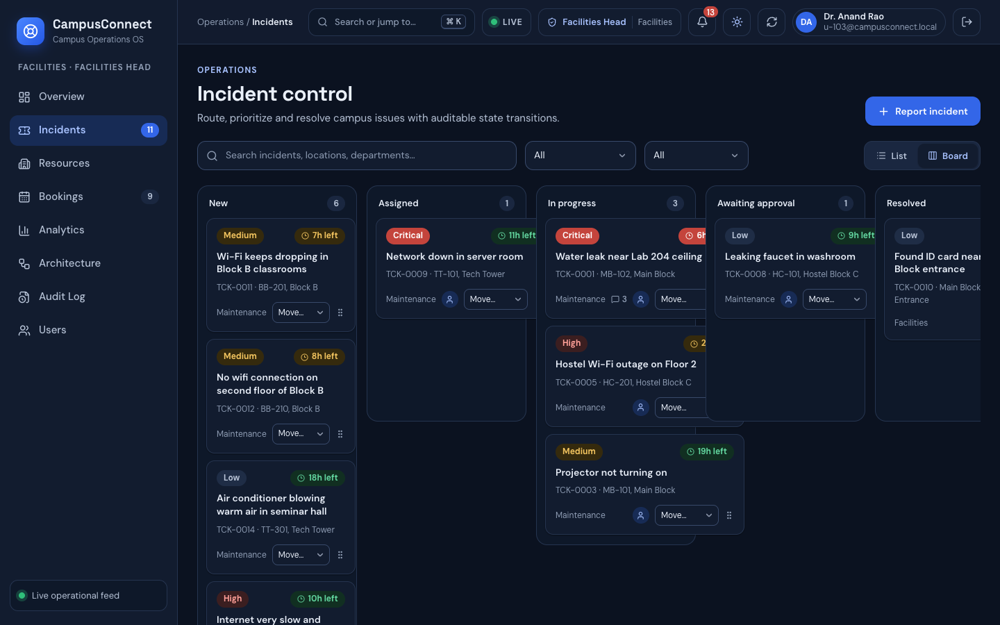</a><br><sub><b>Kanban board</b> — drag cards through the real workflow</sub></td>
<td width="50%"><a href="docs/screenshots/04-incident-comments.png">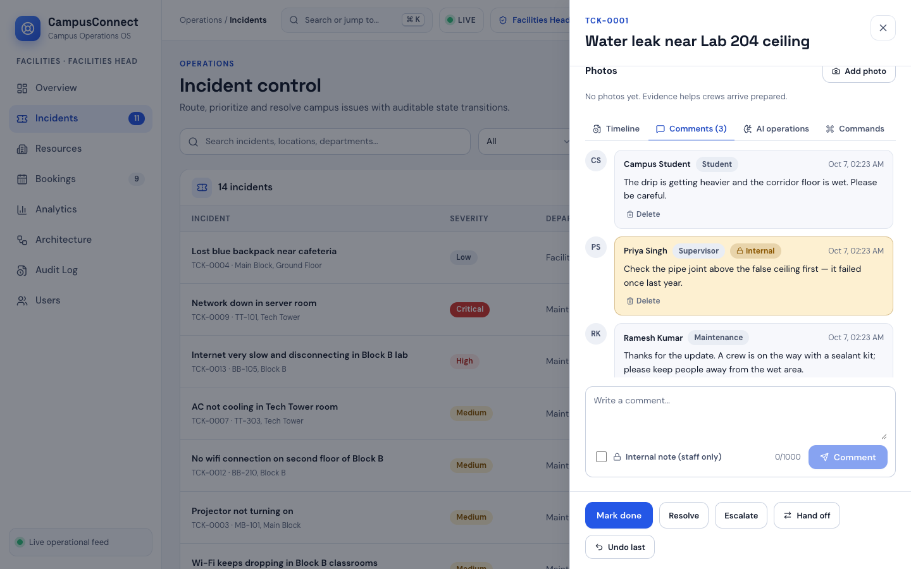</a><br><sub><b>Comments</b> with staff-only internal notes</sub></td>
</tr>
<tr>
<td><a href="docs/screenshots/05-booking-approvals.png">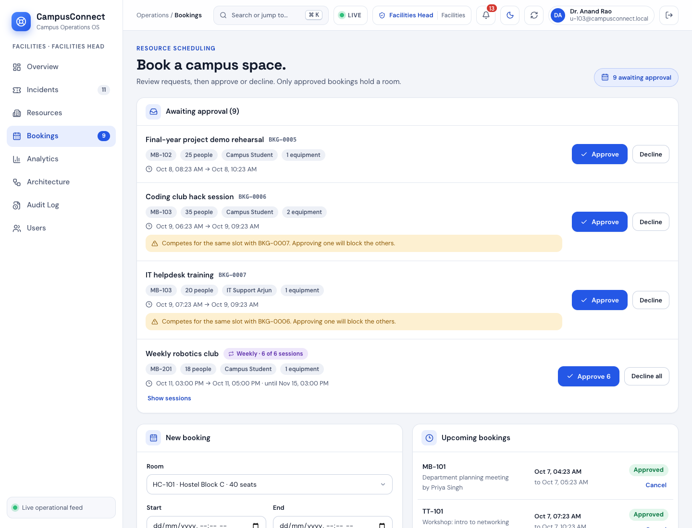</a><br><sub><b>Booking approvals</b> — one card per recurring series</sub></td>
<td><a href="docs/screenshots/06-recurring-booking.png">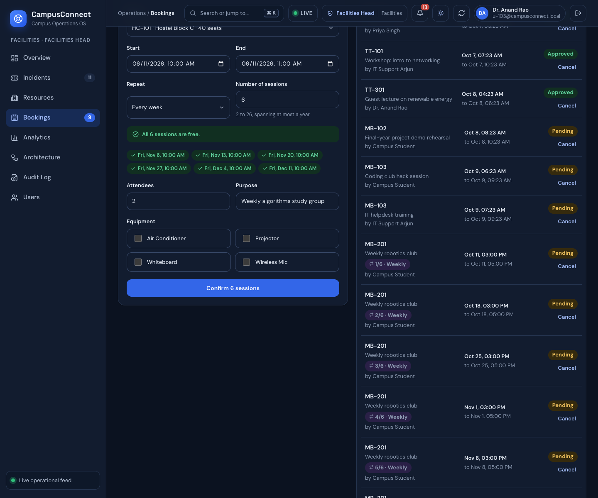</a><br><sub><b>Recurring bookings</b> with per-session availability</sub></td>
</tr>
<tr>
<td><a href="docs/screenshots/09-report-smart-triage.png">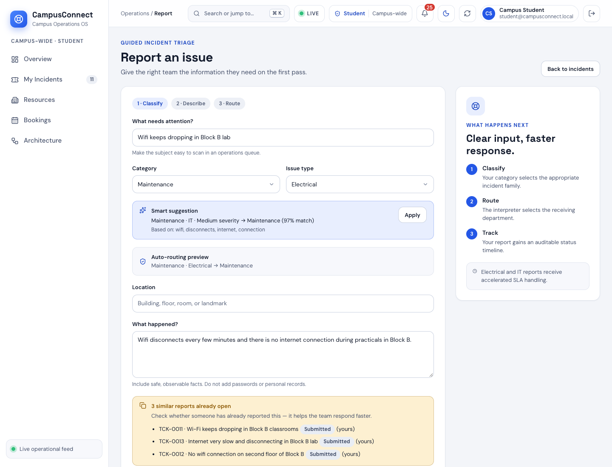</a><br><sub><b>Smart triage</b> and duplicate warnings while reporting</sub></td>
<td><a href="docs/screenshots/10-command-palette.png">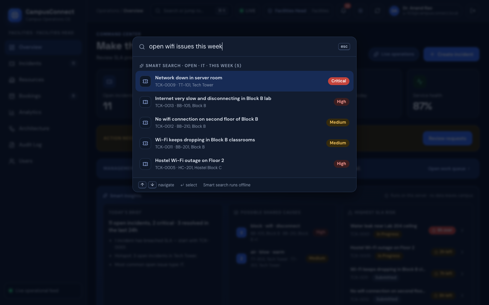</a><br><sub><b>Command palette</b> with natural-language search</sub></td>
</tr>
<tr>
<td><a href="docs/screenshots/07-analytics.png">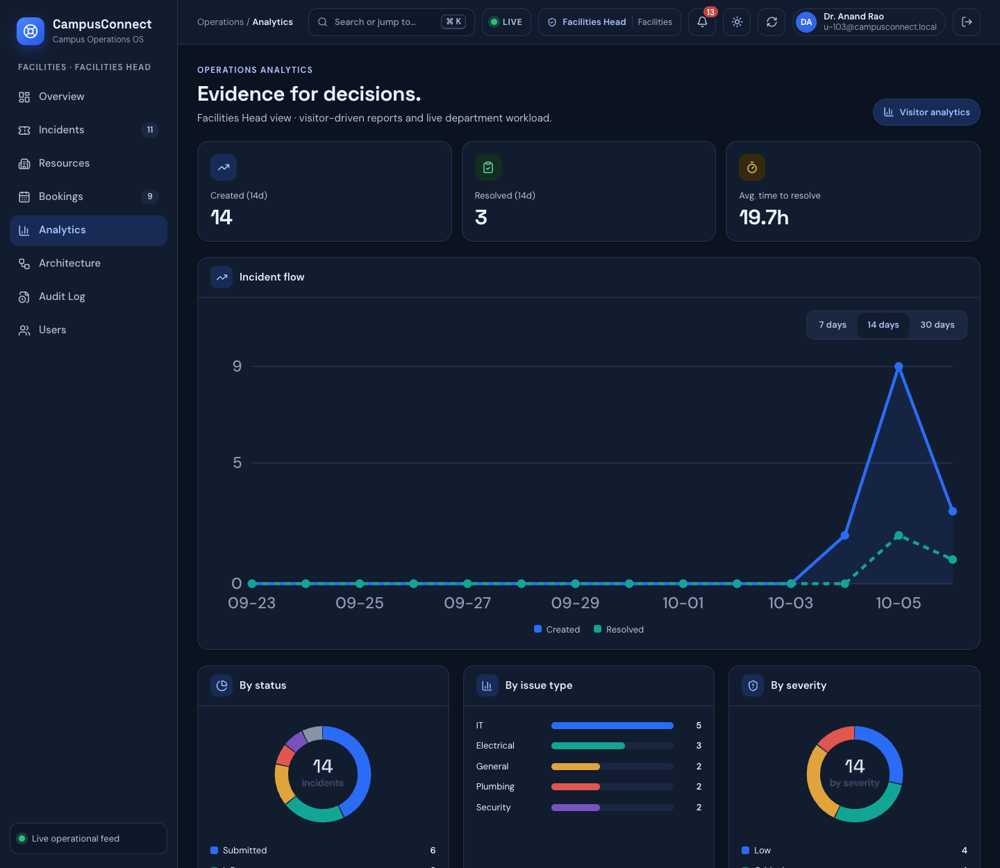</a><br><sub><b>Analytics</b> — dependency-free SVG charts</sub></td>
<td><a href="docs/screenshots/08-users-roles.png">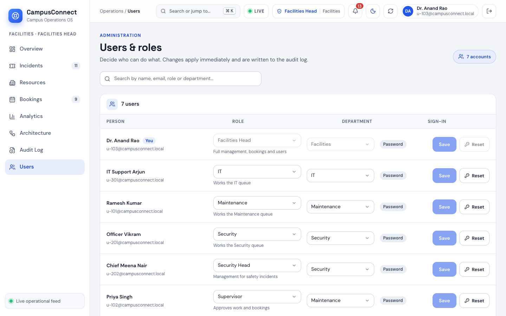</a><br><sub><b>Users &amp; roles</b> administration</sub></td>
</tr>
</table>

<details>
<summary>Login page</summary>

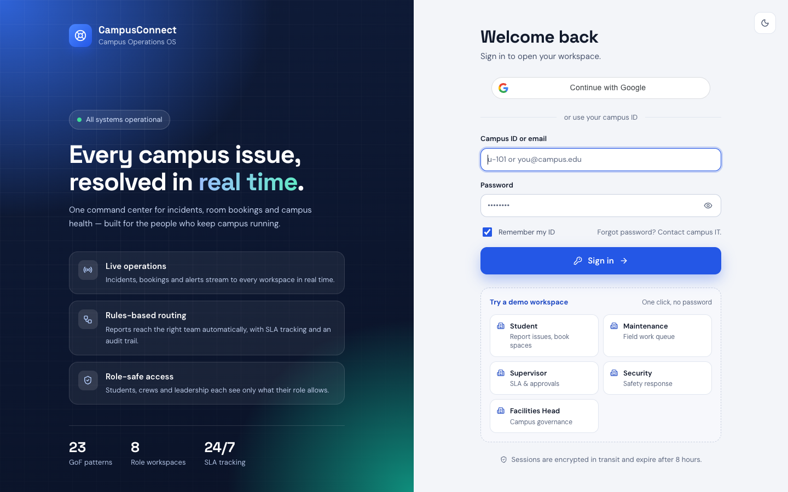

</details>

## Quick start

**Requirements:** Node.js **≥ 22.5** (uses the built-in `node:sqlite`).

```bash
git clone https://github.com/anshultripathi-dev/CampusConnectV3.git
cd CampusConnectV3
npm install
npm run web:install
npm run build
npm start
```

Open **<http://localhost:3000>** and click a **demo workspace** (for example *Facilities Head*) — no password needed. The database is created and seeded with demo data on first start.

Prefer to type credentials? Use `u-103` (Facilities Head), `u-102` (Supervisor), `u-101` (Maintenance), `u-201` (Security), `u-301` (IT) or `student@campusconnect.local`, all with password **`campus123`**. See [all demo accounts](docs/FEATURES.md#demo-accounts).

### Docker

```bash
docker compose up -d --build        # http://localhost:3000
```

Data lives in a named volume. Running in production? Read the [deployment guide](docs/DEPLOYMENT.md) — demo mode is switched off there and the first sign-in is different.

### Live-reload development

```bash
npm run dev        # backend on :3000
npm run web:dev    # Vite on :5173 (proxies /api)
```

## Configuration

Everything is optional; copy [`.env.example`](.env.example) to `.env`.

| Setting | Purpose |
|---|---|
| `GOOGLE_CLIENT_ID`, `GOOGLE_ALLOWED_DOMAINS` | Enable Google sign-in (needs internet) and restrict it to campus domains |
| `ANTHROPIC_API_KEY` | Optional Claude analysis in the incident drawer — all other AI is offline |
| `NODE_ENV=production` | Hides demo mode and demo data, randomises the seeded password |
| `CAMPUSCONNECT_DEMO_PASSWORD` | Bootstrap password for seeded accounts (**set before the first production start**) |
| `CORS_ORIGINS`, `TRUST_PROXY` | Browser origins allowed, and proxy awareness for rate limiting |
| `PORT`, `CAMPUSCONNECT_DB`, `CAMPUSCONNECT_UPLOADS` | Port and storage locations |

Full reference: [`docs/DEPLOYMENT.md`](docs/DEPLOYMENT.md#configuration).

## How it works

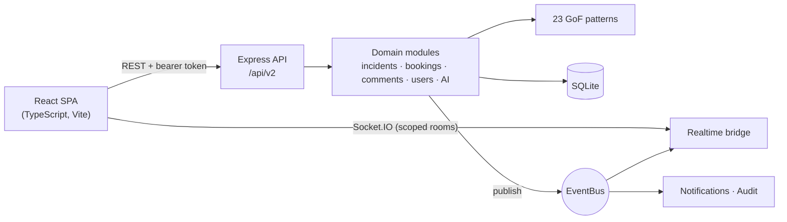

A deeper tour with sequence and state diagrams: [`docs/ARCHITECTURE.md`](docs/ARCHITECTURE.md).

**Tech stack** — Node.js 22 · Express · SQLite (`node:sqlite`) · Socket.IO · React 19 · TypeScript · Vite · Lucide icons · `node:test` · Docker · GitHub Actions.

## Design patterns

All 23 GoF patterns are implemented in [`src/patterns/`](src/patterns/) and composed by the domain modules — for example **Facade → Decorator → Interpreter → Repository → Memento → Observer** when an incident is submitted, **Command + State** for every workflow action (with undo that survives restarts), **Builder** for every booking and **Observer** for notifications and live updates. The Architecture Observatory page shows the real trace of each operation. Mapping: [`docs/DESIGN_PATTERNS.md`](docs/DESIGN_PATTERNS.md).

## Testing

```bash
npm test            # 65 automated tests (unit + HTTP) on throwaway databases
npm run smoke       # end-to-end smoke test
npm run check       # tests + smoke + frontend type-check/build (what CI runs)
```

Tests cover authentication and sessions, role/department scoping (including the *refused* cases), booking approvals and recurring series, comment privacy, notifications, user administration, migrations, uploads, the offline AI, and ID safety across restarts. See [`docs/DEVELOPMENT.md`](docs/DEVELOPMENT.md#testing).

## Documentation

| | |
|---|---|
| [Features & permissions](docs/FEATURES.md) | What each role can do; how workflows behave |
| [Architecture](docs/ARCHITECTURE.md) | Diagrams, flows, security, design decisions |
| [API reference](docs/API.md) | Every endpoint, roles, examples, real-time events |
| [Database](docs/DATABASE.md) | Schema, ER diagram, migrations, backups |
| [Offline AI](docs/AI.md) | How the smart features work and their limits |
| [Design patterns](docs/DESIGN_PATTERNS.md) | Where each of the 23 patterns is used |
| [Development](docs/DEVELOPMENT.md) | Setup, conventions, testing, common tasks |
| [Deployment](docs/DEPLOYMENT.md) | Docker, configuration, HTTPS, backups, checklist |
| [Migration V1 → V2 → V3](docs/MIGRATION.md) | What changed, breaking changes, upgrade steps |
| [Changelog](CHANGELOG.md) | Release notes |

## Version history

| Version | What it was |
|---|---|
| **V1** | Teaching prototype: the 23 patterns in a campus domain, **in-memory** data, a vanilla-JS UI with a role *dropdown* (no login) |
| **V2** (2.0 – 2.3) | **Modular monolith**: SQLite persistence, real authentication and RBAC, audit log, EventBus + Socket.IO, React/TypeScript UI, Architecture Observatory, AI duplicate detection |
| **V3** (this release) | **Complete workflows and a hardened platform**: booking approvals and recurring series, comments with internal notes, offline AI, users & roles, scoped real-time, migrations, new design system, Docker and CI — and the legacy code removed |

Upgrading from V2? Your database migrates automatically, but read the [migration guide](docs/MIGRATION.md) first (sessions are reset, bookings are grandfathered as approved, legacy API routes are gone, and a V2 data-integrity bug is explained there).

## Project structure

```
├── server.js                 Express + Socket.IO bootstrap
├── src/
│   ├── patterns/             23 GoF implementations
│   └── v2/                   domain modules, routes, AI, infrastructure
├── frontend/                 React + TypeScript app
├── tests/                    unit + HTTP test suites
├── scripts/                  smoke test
├── data/seed.json            reference data
├── docs/                     documentation (+ screenshots, history)
├── Dockerfile · docker-compose.yml
└── .github/                  CI, templates, Dependabot
```

## Roadmap

Ideas, roughly in priority order — contributions welcome:

- [ ] "Create user" form (admin-provisioned accounts)
- [ ] `httpOnly` cookie sessions instead of a bearer token in `localStorage`
- [ ] Frontend component tests (Vitest + Testing Library)
- [ ] Calendar view and `.ics` export for bookings
- [ ] CSV/PDF export of reports
- [ ] Train the SLA-risk weights on real resolution history
- [ ] Optional PostgreSQL backend behind the repository layer
- [ ] Installable PWA with push notifications
- [ ] Internationalisation

*Email/SMS delivery is intentionally out of scope: notifications are in-app.*

## Contributing

Contributions are welcome — please read [`CONTRIBUTING.md`](CONTRIBUTING.md) and the [Code of Conduct](CODE_OF_CONDUCT.md). Report security issues privately as described in [`SECURITY.md`](SECURITY.md).

## License

[MIT](LICENSE) © 2026 Anshul Tripathi

## Author

Built by **Anshul Tripathi** as a Design Patterns course project and grown into a complete campus operations platform.
