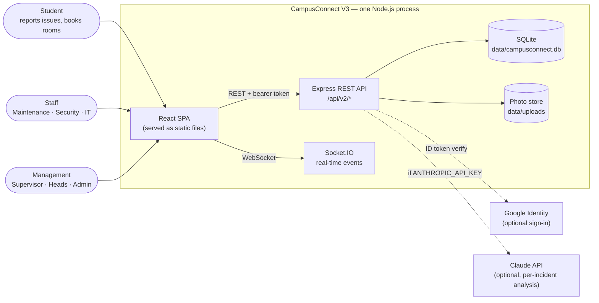
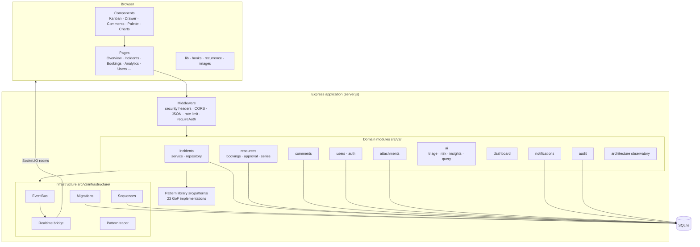
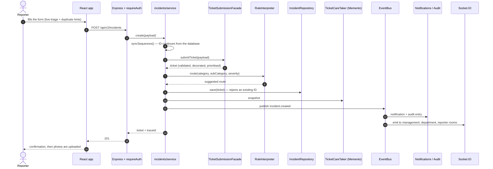
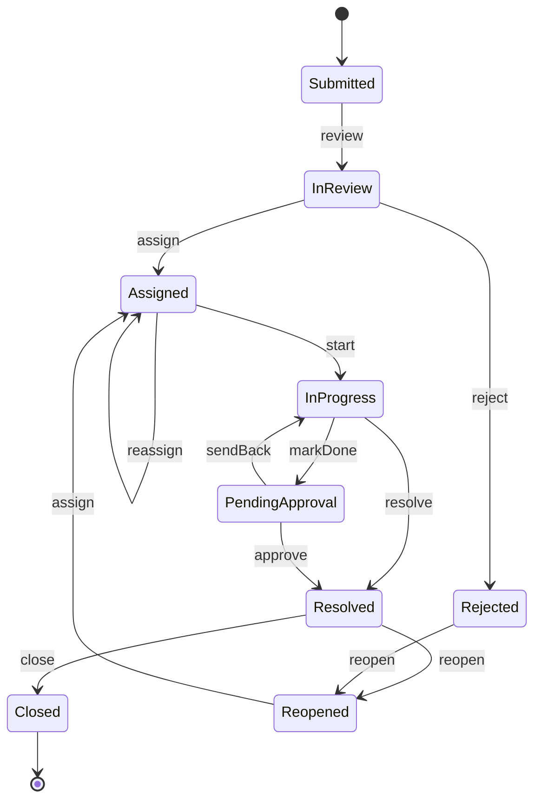
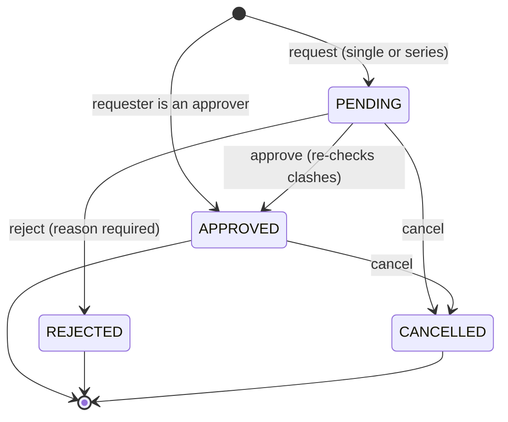
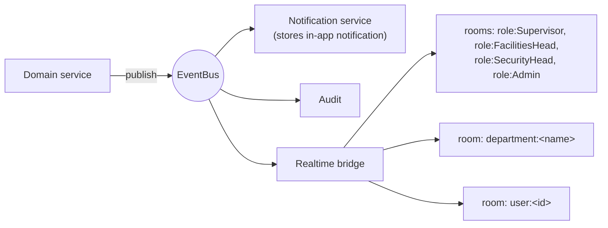

# Architecture

CampusConnect V3 is a **modular monolith**: one Node.js process, one SQLite database, clear module boundaries, and the **23 Gang-of-Four patterns** used as working parts of real workflows (see [`DESIGN_PATTERNS.md`](DESIGN_PATTERNS.md)).

- [System context](#system-context)
- [Containers and modules](#containers-and-modules)
- [Request flow: submitting an incident](#request-flow-submitting-an-incident)
- [Incident lifecycle](#incident-lifecycle)
- [Booking lifecycle](#booking-lifecycle)
- [Event-driven flow and real-time delivery](#event-driven-flow-and-real-time-delivery)
- [Security architecture](#security-architecture)
- [Frontend architecture](#frontend-architecture)
- [Design decisions](#design-decisions)
- [Repository layout](#repository-layout)

## System context



Everything except the two dotted lines works **offline**.

## Containers and modules



| Layer | Responsibility |
|---|---|
| **Pages / components** | Rendering, local UI state, calling the API. No business rules beyond *hiding* what the server would refuse |
| **Middleware** | Authentication (`requireAuth`), rate limiting, CORS, security headers |
| **Routes** (`src/v2/routes.js`) | HTTP mapping, role checks, request validation; thin |
| **Domain modules** | Business rules: incident workflow, booking approval/series, comments, users, AI |
| **Repositories** | The only code that writes SQL for their aggregate (`incidents/repository.js`, `resources/repository.js`); everything else goes through them or a small query helper |
| **Pattern library** | Reusable GoF implementations the domain modules compose |
| **Infrastructure** | SQLite connection, migrations, EventBus, realtime bridge, ID sequences, pattern tracer |

## Request flow: submitting an incident



The **Architecture Observatory** page lists the real pattern trace of each operation (`pattern_traces`).

## Incident lifecycle



`assign` and `reject` from **Submitted** perform the implicit `review` step. The rules live in `src/patterns/behavioral/state.js`; which **role** may run which command is enforced separately in `src/v2/auth.js` and mirrored in the UI so it only shows legal actions. Every command is persisted (`command_history`) so the latest one can be **undone** — even after a restart — as long as the incident has not changed since.

## Booking lifecycle



- Only **APPROVED** bookings hold a room; pending requests never block anyone.
- A **series** is a set of ordinary bookings sharing a `series_id`; approve/decline/cancel can target one session or the whole series.
- See [`FEATURES.md`](FEATURES.md#room-bookings).

## Event-driven flow and real-time delivery

Domain code publishes events to an in-process **EventBus** (Observer pattern). Subscribers persist notifications, write audit entries and bridge selected events to Socket.IO.



Sockets authenticate with the **same bearer token** as the REST API and join `role:`, `department:` and `user:` rooms. Each event is delivered **only** to the rooms entitled to it:

| Event | Delivered to |
|---|---|
| `incident.created` / `incident.updated` | management, the owning department, the reporter, the assignee |
| `incident.comment` | as above, **excluding the reporter for internal notes**; carries no comment text |
| `booking.created` / `booking.updated` | management and the requester |
| `notification.created` | the addressed user, department, or all management (`operations`) |
| `audit.created` | management |

## Security architecture

| Concern | Mechanism |
|---|---|
| **Passwords** | `scrypt` with per-user salt; timing-safe comparison |
| **Sessions** | Random 256-bit tokens; only the SHA-256 **hash** is stored in `sessions`; 8-hour expiry; revoked on logout, password change/reset |
| **Brute force** | 10 sign-in attempts / 15 min / IP (also on password change) |
| **Google sign-in** | ID token verified server-side (signature, audience, expiry, verified email); optional domain allow-list; new accounts are **Students** |
| **Authorisation** | Server-enforced role → command table; students see only their incidents/bookings; staff see their department; every route checks access |
| **Data scoping** | Realtime rooms, notification audiences and comment visibility (internal notes) |
| **Uploads** | Type **and** magic-byte validation, size/count limits, random server-side file names, served only to authorised users |
| **Transport hygiene** | `nosniff`, `X-Frame-Options: DENY`, referrer policy, COOP; no `x-powered-by`; CORS allow-list |
| **Auditability** | `audit_logs` with before/after state for mutations, role changes, password resets, deletions |
| **Defaults** | Demo mode and the shared demo password are disabled when `NODE_ENV=production` |

Reporting a vulnerability: [`../SECURITY.md`](../SECURITY.md).

## Frontend architecture

```
frontend/src/
├── main.tsx            entry point
├── App.tsx             session bootstrap → Login or Console
├── Console.tsx         shell: sidebar, header, routing between pages, sockets, toasts
├── Login.tsx           split-screen sign-in (password, Google, demo workspaces)
├── pages/              Overview · Incidents · IncidentReport · Bookings · Resources
│                       Analytics · Audit · Architecture · Users
├── components/         KanbanBoard · IncidentDrawer · IncidentActions · CommentsPanel
│                       PhotoGallery · CommandPalette · Charts · AiInsights · …
├── lib.ts · hooks.ts   API client, role helpers, shared hooks
├── recurrence.ts       timezone-correct session generation for recurring bookings
├── images.ts           client-side photo downscaling
├── types.ts            shared TypeScript types
└── styles.css          the single design system (tokens, components, responsive rules)
```

- **State** is local React state plus `Console`-level data loading; Socket.IO events trigger reloads. There is deliberately no global store.
- **Design system**: every colour comes from a CSS custom property; dark mode swaps the values. Text never goes below 12 px and passes WCAG AA contrast (checked by a script across all views in both themes).
- **Offline-first**: fonts are bundled, charts are dependency-free SVG, and the only network call to a third party is the optional Google button.

## Design decisions

| Decision | Why |
|---|---|
| **Modular monolith** over microservices | One deployable unit, transactional integrity, trivial local setup; modules are isolated enough to split later |
| **SQLite via `node:sqlite`** | Zero infrastructure, ideal for a campus-scale deployment; repositories keep SQL contained so PostgreSQL could replace it |
| **Versioned migrations** | Safe upgrades of existing databases; each runs once in a transaction |
| **Offline AI** | Works in a classroom with no internet and keeps data on the server; the model choices are explainable (Naive Bayes, TF-IDF, weighted scoring) |
| **Session tokens hashed in the database** | A leaked database does not leak usable tokens; sessions survive restarts |
| **Approval before a booking holds a room** | Prevents anyone from blocking rooms; matches how campuses actually run |
| **Series as independent bookings** | Each session can be approved, rejected or cancelled on its own without special cases elsewhere |
| **Scoped realtime delivery** | Live updates must obey the same visibility rules as the REST API |
| **Pattern tracing built in** | The patterns are demonstrably *used*, not just present |

## Repository layout

```
CampusConnect/
├── server.js                  Express + Socket.IO bootstrap
├── src/
│   ├── patterns/              23 GoF implementations (creational/structural/behavioral)
│   ├── services/aiService.js  optional Claude adapter + heuristics
│   └── v2/
│       ├── routes.js · auth-routes.js · auth.js · users.js · comments.js
│       ├── attachments.js · rateLimit.js · audit.js · seedDemoData.js
│       ├── ai/                offline triage, TF-IDF, risk, clusters, NL query
│       ├── incidents/ · resources/ · dashboard/ · notifications/ · architecture/
│       └── infrastructure/    database · migrations · sequences · eventBus · realtime · patternTracer
├── frontend/                  React + TypeScript + Vite app
├── data/seed.json             reference data (campus, rooms, equipment, staff)
├── tests/                     node:test suites (unit + HTTP)
├── scripts/smoke-v2.js        end-to-end smoke test (temporary database)
├── docs/                      this documentation
├── Dockerfile · docker-compose.yml
└── .github/                   CI, issue/PR templates, Dependabot
```
