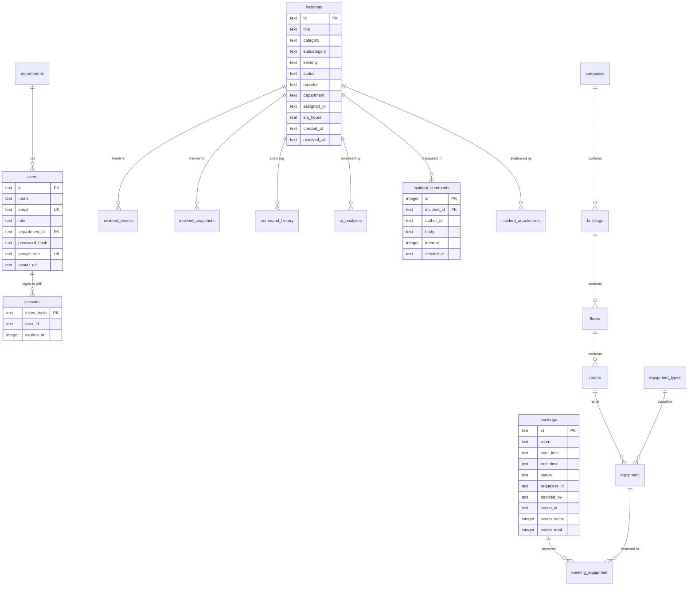

# Database

CampusConnect stores everything in one **SQLite** file, `data/campusconnect.db` (override with `CAMPUSCONNECT_DB`), accessed through Node's built-in `node:sqlite`. Foreign keys are enabled. Photos are files on disk (`data/uploads`, override with `CAMPUSCONNECT_UPLOADS`) with metadata in the database.

- [Entity-relationship diagram](#entity-relationship-diagram)
- [Tables](#tables)
- [Migrations](#migrations)
- [Writing a migration](#writing-a-migration)
- [IDs](#ids)
- [Seeding](#seeding)
- [Backup and restore](#backup-and-restore)
- [Moving to PostgreSQL](#moving-to-postgresql)

## Entity-relationship diagram



## Tables

| Table | Purpose | Notes |
|---|---|---|
| `schema_migrations` | Applied migration ids | See [Migrations](#migrations) |
| `departments`, `users` | People and roles | `role` ∈ Student, Maintenance, Security, IT, Supervisor, FacilitiesHead, SecurityHead, Admin. `password_hash` is `salt:scrypt`; `google_sub` links a Google account |
| `sessions` | Sign-in sessions | **Only the SHA-256 hash** of the token is stored; `expires_at` is epoch ms |
| `incidents` | The incident record | Status follows the [lifecycle](ARCHITECTURE.md#incident-lifecycle); `sla_hours` drives risk scoring |
| `incident_events` | Timeline | One row per state change, escalation, hand-off, undo |
| `incident_snapshots` | Memento snapshots | Used by *restore* |
| `command_history` | Persistent Command log | `before_state` / `after_state` JSON; `undone_at` marks undone commands |
| `incident_comments` | Comments and internal notes | `internal=1` is staff-only; deletes are soft (`deleted_at`) |
| `incident_attachments` | Photo metadata | Files live under the uploads directory; `storage_path` is relative and never user-controlled |
| `ai_analyses` | Stored per-incident AI analyses | |
| `campuses`, `buildings`, `floors`, `rooms` | Campus hierarchy (Composite pattern) | Seeded from `data/seed.json` |
| `equipment_types`, `equipment` | Shared equipment (Flyweight) | |
| `bookings`, `booking_equipment`, `booking_templates` | Room bookings | `status` ∈ PENDING, APPROVED, REJECTED, CANCELLED; `series_*` link recurring sessions; times are UTC ISO-8601 |
| `notifications` | In-app notifications | `recipient` is a user id, a department name, or `operations` |
| `audit_logs` | Immutable-by-convention audit trail | Actor, action, entity, before/after JSON |
| `pattern_traces` | Architecture Observatory traces | |

Indexes (17) cover the hot paths: incidents by status/department/reporter/created, events by incident, notifications by recipient, bookings by room/time/status/series, sessions by expiry/user, comments and attachments by incident.

## Migrations

Defined in [`src/v2/infrastructure/migrations.js`](../src/v2/infrastructure/migrations.js) and run at start-up from `database.js`.

| Id | Summary |
|---|---|
| `001_booking_requester` | `bookings.requester_id` |
| `002_user_auth_columns` | `users.password_hash`, `google_sub`, `avatar_url` + unique index on `google_sub` |
| `003_sessions` | `sessions` table + indexes |
| `004_query_indexes` | Performance indexes |
| `005_incident_attachments` | Photo metadata table |
| `006_booking_approval` | Decision columns; **existing `PENDING` bookings become `APPROVED`** |
| `007_booking_series` | Recurring-booking columns |
| `008_incident_comments` | Comments table |

Guarantees: each migration runs **once**, inside a **transaction** (a failure rolls back and stops start-up), and is **idempotent** (`addColumn` checks `PRAGMA table_info` first). The core `CREATE TABLE IF NOT EXISTS` schema in `database.js` is the V2 baseline; everything since is a migration.

Upgrade notes for existing installations: [`MIGRATION.md`](MIGRATION.md#database-migrations-001008).

## Writing a migration

1. Append an entry to `MIGRATIONS` — **never edit or reorder a shipped one**:
   ```js
   {
     id: '009_short_description',
     up: db => {
       addColumn(db, 'incidents', 'example', 'TEXT');
       db.exec('CREATE INDEX IF NOT EXISTS idx_incidents_example ON incidents(example)');
     },
   },
   ```
2. Keep it additive where possible; if it rewrites data, say so in [`MIGRATION.md`](MIGRATION.md) and the changelog.
3. Add or update tests (`tests/api.test.js` checks that migrations are recorded and re-running is a no-op).
4. Run `npm test`.

## IDs

Incidents are `TCK-NNNN`, bookings `BKG-NNNN`, recurring series `SER-xxxxxxxx`.

The pattern library hands out sequential IDs from in-memory counters that **restart at 1 on every boot**. `src/v2/infrastructure/sequences.js` therefore moves the counters past the highest ID in the database **before every allocation**, and `incidents/service.js` refuses to save an incident whose ID already exists. Do not bypass these when adding creation paths. Background: [`MIGRATION.md`](MIGRATION.md#a-data-integrity-bug-fixed-in-v3).

## Seeding

On an **empty** database the app loads reference data from `data/seed.json` and demo content from `src/v2/seedDemoData.js`: ~14 incidents (including a cluster of related Wi-Fi reports), approved and pending bookings, a recurring request and a sample comment thread. All demo content is created through the real services, so audit entries, notifications and pattern traces exist exactly as they would for real use.

Safeguards: demo seeding is skipped when `NODE_ENV=production` (opt in with `CAMPUSCONNECT_SEED_DEMO=1`), and the add-on seeds (extra incidents, pending requests, comments) only run against databases that contain **demo data only**.

## Backup and restore

SQLite can be backed up with a consistent copy while the server runs:

```bash
# consistent copy (preferred)
sqlite3 data/campusconnect.db ".backup 'backup-$(date +%F).db'"
# or, from Node, with no sqlite3 binary:
node -e "const {DatabaseSync}=require('node:sqlite');new DatabaseSync('data/campusconnect.db').exec(\"VACUUM INTO 'backup.db'\")"
```

Also back up `data/uploads/`. To restore: stop the server, replace `data/campusconnect.db` (and delete stale `-wal`/`-shm` files), start the server. `data/backups/` is git-ignored and a good place to keep local copies.

## Moving to PostgreSQL

Not needed at campus scale, but the design allows it: SQL is concentrated in the repositories and a few small query helpers (`users.js`, `comments.js`, `attachments.js`, `notifications/service.js`). A port would replace `database.js`, translate the SQLite-specific bits (`PRAGMA`, `INSERT … ON CONFLICT`, `datetime()`), and run the migrations list through a PostgreSQL runner.
