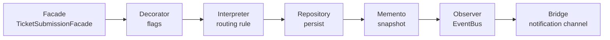

# The 23 Gang-of-Four patterns

CampusConnect began as a way to show all 23 GoF patterns in one coherent domain, and the rule has stayed the same: **each pattern earns its place by doing real work in a workflow**, not by sitting in an examples folder. The implementations live in [`src/patterns/`](../src/patterns/) and are composed by the domain modules in `src/v2/`.

The **Architecture Observatory** page (and `GET /api/v2/architecture/patterns`) exposes the catalogue as `5 + 7 + 11 = 23`, and records an execution **trace** for each operation so you can see which patterns a request actually passed through.

## Creational (5)

| Pattern | Implementation | Where it works in the app |
|---|---|---|
| **Singleton** | `CampusRegistry` | Shared campus/reference data and ID generation. *V3 note:* its in-memory counters restart on boot, so `infrastructure/sequences.js` re-synchronises them with the database before every allocation |
| **Abstract Factory** | Incident category families | Each category yields a matching validator, router and notification template |
| **Factory Method** | `ReportFactory` | Creates the specialised report subtypes behind `/analytics/report/:type` |
| **Builder** | `BookingBuilder` | Assembles every booking — single bookings and each session of a recurring series — step by step |
| **Prototype** | `BookingTemplateRegistry` | Clonable booking templates (the registry remains; its V1 HTTP endpoints were retired in V2 and the use case is covered by recurring bookings) |

## Structural (7)

| Pattern | Implementation | Where it works in the app |
|---|---|---|
| **Adapter** | `LegacyIdCardAdapter` | Translates legacy ID-card records into requester profiles when a booking carries a `cardNo` |
| **Bridge** | Notification type ↔ Email/SMS/Push channels | Notification kinds are decoupled from delivery channels (in-app is the shipped channel) |
| **Composite** | Campus → Building → Floor → Room | The campus tree on the Resources page |
| **Decorator** | Incident flags (Urgent, VIP, Repeat-Issue) | Adds behaviour/priority to an incident at runtime |
| **Facade** | `TicketSubmissionFacade` | One call validates, decorates and prioritises a new incident |
| **Flyweight** | `EquipmentFlyweightFactory` | Shares equipment metadata across bookings |
| **Proxy** | `SecureTicketProxy` | Controlled, role-aware views of sensitive (Safety) incidents |

## Behavioral (11)

| Pattern | Implementation | Where it works in the app |
|---|---|---|
| **Chain of Responsibility** | Supervisor → Facilities Head → Admin | Escalation of incidents that exceed their SLA |
| **Command** | `Assign/Start/MarkDone/Approve/SendBack/Resolve/Close/Reopen/Reject` + invoker | Every incident action; persisted in `command_history` so **undo works across restarts** |
| **Interpreter** | `RuleInterpreter` | Parses routing rules like `IF category=Maintenance AND subCategory=Electrical THEN route=…` |
| **Iterator** | `TicketHistoryIterator` | Walks an incident's history |
| **Mediator** | `DepartmentMediator` | Department-to-department hand-offs without departments knowing each other |
| **Memento** | `TicketCareTaker` | Snapshots and restoration |
| **Observer** | `EventBus` subscribers | Notifications, audit and real-time delivery react to domain events |
| **State** | `TicketStateMachine` | The incident [lifecycle](ARCHITECTURE.md#incident-lifecycle); illegal transitions fail near the rule |
| **Strategy** | `TicketRanker` + SLA / severity / FIFO strategies | Queue ranking |
| **Template Method** | `getResolutionProcess(category)` | A resolution workflow skeleton with category-specific steps |
| **Visitor** | Maintenance-cost, safety and room-utilisation visitors | Analytics over mixed collections of incidents and bookings |

## Example: how patterns compose when an incident is submitted

Open **Architecture → Live execution traces** after creating an incident to see exactly this path recorded.

## Patterns-in-spirit added in V3

These are **not** counted in the 23 and are not in the catalogue, but follow the same ideas:

| Idea | Where |
|---|---|
| **Facade** | `src/v2/ai/index.js` hides the tokenizer, classifier, index and scorers behind a few functions |
| **Strategy** | Interchangeable scorers: Naive Bayes triage, keyword-weight severity, weighted SLA risk |
| **Interpreter** | `src/v2/ai/query.js` parses natural-language queries into a filter expression and evaluates it against incidents |
| **Adapter** | `src/v2/services/aiAdapter.js` presents the optional Claude client and the local models behind one incident-analysis API |
| **Command + State** | Kanban drag-and-drop calls the same command pipeline, so board moves obey the same state machine and role rules |
| **Observer** | `incident.comment`, `booking.updated` events fan out to notifications and room-scoped sockets |

## Testing the patterns

`npm run smoke` exercises the Facade → Interpreter → Repository → Memento → Observer path, the Command history with persistent undo, booking Builder conflict handling and the pattern trace. `npm test` covers the surrounding behaviour.
