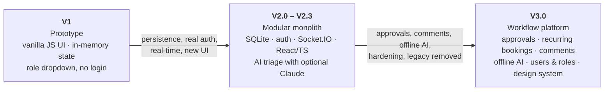

# Migration guide: V1 → V2 → V3

CampusConnect has been through three generations. This document records **what changed at each step, why, and what you must do** when moving a codebase or a database from one generation to the next.

- [At a glance](#at-a-glance)
- [V1 — the original prototype](#v1--the-original-prototype)
- [V1 → V2](#v1--v2)
- [V2 → V3](#v2--v3)
  - [Upgrading an existing V2 installation](#upgrading-an-existing-v2-installation)
  - [Breaking changes](#breaking-changes)
  - [Database migrations 001–008](#database-migrations-001008)
  - [Behaviour changes you will notice](#behaviour-changes-you-will-notice)
  - [Configuration changes](#configuration-changes)
  - [Frontend changes](#frontend-changes)
  - [A data-integrity bug fixed in V3](#a-data-integrity-bug-fixed-in-v3)
- [Rollback](#rollback)
- [Where the old code lives](#where-the-old-code-lives)

---

## At a glance



| | **V1** | **V2 (2.0 – 2.3)** | **V3 (3.0)** |
|---|---|---|---|
| **Purpose** | Demonstrate the 23 GoF patterns in a campus domain | Make the patterns drive a real, persistent application | Make it a complete, secure, usable operations product |
| **Backend** | Express, in-memory `CampusRegistry` | Modular monolith, SQLite (`node:sqlite`), EventBus, Socket.IO | Same, plus migrations, scoped realtime, comments, series, approvals |
| **Persistence** | None — data lost on restart | SQLite, schema created on boot | SQLite with **versioned migrations** (001–008) and indexes |
| **Authentication** | None. The browser sends the role it *claims* to have | Password login (scrypt), bearer tokens, in-memory sessions (8 h) | Persistent hashed sessions, rate limiting, optional Google sign-in, password change/reset |
| **Authorisation** | Client-supplied role | Server-enforced RBAC + department scoping | Same, plus per-feature rules (bookings, comments, users) |
| **Roles** | Student, Maintenance, Security, IT, Admin | + Supervisor, Facilities Head, Security Head | Same roles, now manageable from the UI |
| **Frontend** | Vanilla JS single page (`public/`, ~660 lines JS) | React + TypeScript + Vite (one large `main.tsx`) | React + TypeScript, split into pages/components, token-based design system, light/dark |
| **Real-time** | None (manual refresh) | Socket.IO, events broadcast to all clients | Socket.IO with **room-scoped** delivery |
| **AI** | Claude triage, heuristic fallback | + duplicates, recommendations | **Fully offline** triage, similarity, SLA risk, clusters, natural-language search |
| **API** | `/api/tickets`, `/api/bookings`, `/api/campus`, `/api/ai` | `/api/v2/*` (legacy routes kept) | `/api/v2/*` only (legacy routes **removed**) |
| **Tests** | None | One smoke script | 63 automated tests + smoke script + CI |
| **Packaging** | `npm start` | `npm start` | `npm start`, Docker, docker-compose, GitHub Actions |

> **Naming note.** V1 called records *tickets*. From V2 the public API calls them *incidents* (`/api/v2/incidents`), but identifiers keep the `TCK-0001` format and some internal code still says `ticket`. This is intentional — it keeps IDs stable across versions.

---

## V1 — the original prototype

V1 is a teaching prototype: the **23 Gang-of-Four patterns** (`src/patterns/`) wired into a small campus-issue and room-booking app.

- **Server** — `server.legacy.js` (33 lines): Express serving a static `public/` folder and four route groups.
- **State** — held in the `CampusRegistry` singleton as JavaScript `Map`s. **Nothing was persisted**; restarting the server wiped every ticket and booking.
- **"Roles"** — a dropdown in the page (`viewerRole`) chose Student / Maintenance / Security / IT / Admin, and the browser sent that role to the server, which trusted it. `src/services/permissions.js` documented this as a placeholder for real authentication.
- **UI** — a vanilla-JS single page (`public/app.js`, `index.html`, `style.css`) with tabs: board, my tickets, report, booking, campus, insights.
- **AI** — `aiService.js` called Claude when `ANTHROPIC_API_KEY` was set and fell back to keyword heuristics otherwise.
- **API**

  | Route group | Endpoints |
  |---|---|
  | `/api/tickets` | `POST /`, `GET /`, `GET /rank`, `GET /report/:type`, `GET /:id`, `GET /:id/history`, `POST /:id/command/:action`, `POST /:id/undo`, `POST /:id/escalate`, `POST /:id/handoff`, `POST /:id/restore`, `POST /:id/resolve-template` |
  | `/api/bookings` | `POST /`, `POST /from-template/:key`, `GET /`, `GET /templates`, `GET /equipment-stats` |
  | `/api/campus` | `GET /tree`, `/rooms`, `/staff`, `/equipment` |
  | `/api/ai` | `POST /triage`, `POST /summarize/:id`, `GET /campus-brief`, `GET /status` |

---

## V1 → V2

V2 turned the prototype into a **modular monolith** whose patterns sit on real workflows. (Full original notes: [`history/V2_MIGRATION_PLAN.md`](history/V2_MIGRATION_PLAN.md).)

### What changed

| Area | V1 | V2 |
|---|---|---|
| Architecture | Routes → services → in-memory registry | Domain modules (`incidents`, `resources`, `dashboard`, `notifications`, `audit`, `architecture`) over repositories; EventBus decouples side effects |
| Persistence | `Map`s in memory | SQLite at `data/campusconnect.db`; schema created on startup; reference data seeded from `data/seed.json` |
| Auth | Client-sent role | `POST /api/v2/auth/login`, `/me`, `/logout`; passwords hashed with `scrypt`; bearer-token sessions (8 h, in memory) |
| RBAC | Role table in the browser | Role → command table enforced on the server; Student scoped to own incidents, Maintenance/Security/IT to their department |
| Audit | None | `audit_logs` records actor, entity, before/after for every mutation |
| Undo | In-memory Memento/Command | `command_history` persists commands; undo survives restarts and refuses to run if the incident changed since |
| Real-time | None | EventBus bridged to Socket.IO (`incident.created`, `incident.updated`, `booking.created`, `notification.created`, `audit.created`) |
| Frontend | Vanilla JS | React + TypeScript + Vite |
| Observability | — | **Architecture Observatory**: every operation is traced through the patterns it touches (`pattern_traces`) |
| AI | Triage / summary | Adds duplicate detection and recommendations; analyses persisted in `ai_analyses` |
| Notifications | — | Persisted in-app notifications with a Bridge-pattern channel abstraction |

### API mapping

| V1 endpoint | V2 replacement |
|---|---|
| `POST /api/tickets` | `POST /api/v2/incidents` |
| `GET /api/tickets` | `GET /api/v2/incidents` (now role-scoped) |
| `GET /api/tickets/rank` | `GET /api/v2/incidents/rank` |
| `GET /api/tickets/:id`, `/:id/history` | `GET /api/v2/incidents/:id`, `/:id/history` |
| `POST /api/tickets/:id/command/:action` | `POST /api/v2/incidents/:id/command/:action` (role-checked) |
| `/:id/undo`, `/escalate`, `/handoff`, `/restore` | Same names under `/api/v2/incidents/:id/…` |
| `GET /api/tickets/report/:type` | `GET /api/v2/analytics/report/:type` |
| `POST /api/bookings` | `POST /api/v2/bookings` (adds conflict detection, persistence) |
| `GET /api/bookings` | `GET /api/v2/bookings` (scoped to the requester unless management) |
| `GET /api/campus/{tree,rooms,equipment}` | `GET /api/v2/resources/{campus,rooms,equipment}` |
| `GET /api/campus/staff` | `GET /api/v2/staff` |
| `POST /api/ai/triage`, `/summarize/:id` | `POST /api/v2/incidents/:id/ai`, `GET /api/v2/incidents/:id/ai/*` |
| `GET /api/bookings/templates`, `POST /from-template/:key` | *Not exposed.* The Prototype-pattern registry remains in `src/patterns`; the use case is served by recurring bookings in V3 |

### Data migration

**There was nothing to migrate.** V1 never stored data, so V2 starts from the seed in `data/seed.json`. Incident IDs keep the `TCK-NNNN` format and bookings use `BKG-NNNN`.

### Compatibility strategy

During V2 the old `/api/*` routes and `server.legacy.js` were **kept** so the legacy UI could be run side by side (`/legacy`) and used as a rollback path. V3 removes them (see below).

---

## V2 → V3

V3 is the **product** release: it completes the workflows V2 only outlined, closes security and data-integrity gaps found in review, and removes the legacy code.

### Upgrading an existing V2 installation

Migrations are applied **automatically, in order, each in its own transaction** the first time V3 starts. You do not run anything by hand.

1. **Stop** the V2 server.
2. **Back up the database** — this is your rollback:
   ```bash
   cp data/campusconnect.db data/campusconnect.db.v2-backup
   # if present, also copy data/campusconnect.db-wal and -shm
   ```
3. **Get V3** and install:
   ```bash
   npm install
   npm run web:install
   npm run build
   ```
   Requires **Node.js ≥ 22.5** (unchanged from V2).
4. **Start it**: `npm start`. Watch for `Persistent database: …` and no migration errors. A failed migration rolls back and stops the server with `Migration <id> failed: …` — your data is untouched.
5. **Verify**:
   ```bash
   sqlite3 data/campusconnect.db "SELECT id FROM schema_migrations ORDER BY id;"
   # expect 001_booking_requester … 008_incident_comments
   ```
6. **Tell users to sign in again** — V3 sessions are stored differently, so V2 tokens are no longer valid.
7. **Review bookings** (see [behaviour changes](#behaviour-changes-you-will-notice)): existing bookings are now *Approved*.
8. **Check for the ID-reuse problem** if your V2 instance ran for a while — see [A data-integrity bug](#a-data-integrity-bug-fixed-in-v3).

If you run the app in production, also read [`DEPLOYMENT.md`](DEPLOYMENT.md) — V3 hides demo credentials and randomises the seeded password when `NODE_ENV=production`.

### Breaking changes

| # | Change | Impact | Action |
|---|---|---|---|
| 1 | **Legacy API removed**: `/api/tickets`, `/api/bookings`, `/api/campus`, `/api/ai` now return `404` JSON | Any client still on V1 routes breaks | Move to `/api/v2/*` using the [mapping above](#api-mapping) |
| 2 | **Removed files**: `server.legacy.js`, `public/`, `src/routes/`, `src/services/{ticketService,bookingService,permissions}.js`; `npm run legacy` | The legacy UI and rollback entry point are gone | Use the V2 tag/repo if you still need them |
| 3 | **Sessions persisted & invalidated** (hashed in the `sessions` table) | Everyone is signed out once | Sign in again |
| 4 | **Booking lifecycle**: bookings are `PENDING → APPROVED / REJECTED / CANCELLED`; only `APPROVED` blocks a room | Clients that assumed "created = confirmed" must read `status` | Check `status`; see [`FEATURES.md`](FEATURES.md#room-bookings) |
| 5 | **Notifications addressed to audiences** (user, department, `operations`) instead of one recipient id | `GET /notifications` returns more (and correct) items | None for the UI; API clients may see department alerts |
| 6 | **Realtime scoping**: events go only to permitted rooms; `notification.created` is no longer broadcast to everyone | Sockets no longer receive other people's events | Clients must not rely on seeing all events |
| 7 | **CORS** restricted to `CORS_ORIGINS` (default `localhost:3000, localhost:5173`) | Cross-origin browser clients on other origins are refused | Set `CORS_ORIGINS` |
| 8 | **Demo mode off in production** (`/auth/demo-users` → 404, seeded password randomised) | Production can no longer use `campus123` | Set `CAMPUSCONNECT_DEMO_PASSWORD` or create real accounts |
| 9 | **Booking validation**: room must exist, attendees ≤ capacity, start not in the past (API) | Previously accepted bad bookings now return `400` | Fix the client input |
| 10 | **Booking times are normalised to UTC** on the server | Naive local timestamps are interpreted in the server's timezone | Send ISO-8601 with `Z`/offset |
| 11 | **Request body limit** raised to 4 MB (photo uploads) | None | — |
| 12 | **`package.json` scripts**: `legacy` removed; `test`, `dev`, `check`, `web:dev`, `web:format` added | CI/scripts that called `npm run legacy` fail | Update scripts |

### Database migrations 001–008

Each migration is idempotent and recorded in `schema_migrations`. Details: [`DATABASE.md`](DATABASE.md).

| Id | What it does | Data impact |
|---|---|---|
| `001_booking_requester` | Adds `bookings.requester_id` (was an ad-hoc `ALTER` in V2) | None |
| `002_user_auth_columns` | Adds `users.password_hash`, `google_sub`, `avatar_url`; unique index on `google_sub` | None; V2 already added `password_hash` — detected, not repeated |
| `003_sessions` | Creates `sessions` (hashed tokens) + indexes | Existing in-memory sessions are lost |
| `004_query_indexes` | Indexes on incidents, events, notifications, bookings, audit | None; faster queries |
| `005_incident_attachments` | Creates `incident_attachments` (photo metadata) | None |
| `006_booking_approval` | Adds `decided_by`, `decided_at`, `decision_note`; **sets every `PENDING` booking to `APPROVED`** | **Yes** — existing bookings were already blocking rooms, so they are *grandfathered* rather than reappearing as requests |
| `007_booking_series` | Adds `series_id`, `series_index`, `series_total`, `series_pattern` | None; existing bookings are standalone |
| `008_incident_comments` | Creates `incident_comments` + index | None |

New migrations are appended to `src/v2/infrastructure/migrations.js`; never edit a shipped one.

### Behaviour changes you will notice

- **Bookings need approval.** Facilities Head, Supervisor and Admin approve or decline (declining requires a reason). Their own bookings are auto-approved. Approving re-checks for clashes.
- **Recurring bookings.** Daily / weekday / weekly / fortnightly series (2–26 sessions) with per-session conflict preview, one summary notification, series-wide approve/decline, and cancel-one-or-all.
- **Reporters are notified** when staff move their incident; department staff see department alerts; management sees `operations` alerts. In V2 these notifications were written but never shown to anyone.
- **Incident drawer** offers only the legal next steps and asks for what each needs: staff picker for **Assign/Reassign**, a reason for **Reject** / **Send back**, a department for **Hand off**.
  - *Reject* now works from a new incident (V2: unreachable).
  - *Reassign* is wired up (V2: declared but unused).
  - *Reopen* shows only on Resolved/Rejected incidents (V2: shown on the wrong ones).
  - *Hand off* works (V2: crashed).
- **Comments** with staff-only internal notes.
- **Photos** on incidents.
- **Users & roles page** for Admin / Facilities Head; password change for everyone; admin password reset.
- **Offline AI** (see [`AI.md`](AI.md)): live triage suggestions, duplicate warnings, SLA-risk scores, clusters, daily brief, natural-language search. No network or API key needed.
- **Kanban board**, **command palette** (`Ctrl/⌘+K`), **analytics charts**.

### Configuration changes

| Variable | V2 | V3 |
|---|---|---|
| `PORT`, `CAMPUSCONNECT_DB`, `ANTHROPIC_API_KEY`, `CAMPUSCONNECT_DEMO_PASSWORD` | ✔ | ✔ (unchanged) |
| `NODE_ENV=production` | no effect | Hides demo mode, randomises seeded password |
| `CAMPUSCONNECT_DEMO` | — | Force demo mode `1`/`0` |
| `GOOGLE_CLIENT_ID`, `GOOGLE_ALLOWED_DOMAINS` | — | Optional Google sign-in |
| `CORS_ORIGINS` | — | Allowed browser origins |
| `TRUST_PROXY` | — | `1` behind a reverse proxy (correct client IPs for rate limiting) |
| `CAMPUSCONNECT_UPLOADS` | — | Photo storage directory (default `data/uploads`) |

Full list: [`../.env.example`](../.env.example).

### Frontend changes

- `frontend/src/main.tsx` (one ~90-line file of very long lines) was split into `App`, `Console`, `Login`, `pages/*`, `components/*`, `lib`, `hooks`, `types`, `recurrence`, `images`.
- The two stylesheets full of per-theme overrides were replaced by a **single token-based design system** (`frontend/src/styles.css`): light/dark are two sets of values, minimum text size 12 px, WCAG AA contrast.
- Fonts are **bundled** (`@fontsource`) — no CDN requests, so it works offline.
- Dependencies pinned (V2 used `"latest"`); Prettier added (`npm --prefix frontend run format`).
- `localStorage` keys: `campusconnect_token`, `campusconnect_theme`, `campusconnect_last_login`, `campusconnect_incident_view`.

### A data-integrity bug fixed in V3

**V2 (and V1) reset their ID counters to 1 on every start**, and saving an incident used an *upsert*. After a restart the next incident created in a V2 database could therefore **silently overwrite an existing one** (e.g. `TCK-0001`), leaving its event history attached to the wrong record.

V3 fixes the cause:

- IDs continue from the highest existing `TCK-` / `BKG-` number before every allocation.
- Creating an incident whose ID already exists now throws instead of overwriting.
- A regression test (`tests/api.test.js`) fails if either guard is removed.

**If you are upgrading a long-running V2 database**, check whether it was affected. Symptoms: fewer incidents than you expect, or a timeline that mixes unrelated events.

```sql
-- Strongest signal: an incident that was "created" more than once.
SELECT incident_id, COUNT(*) AS created_events
FROM incident_events WHERE event_type = 'CREATED'
GROUP BY incident_id HAVING COUNT(*) > 1;

-- Secondary signal: events that predate the incident they belong to.
SELECT i.id FROM incidents i JOIN incident_events e ON e.incident_id = i.id
GROUP BY i.id HAVING julianday(MIN(e.created_at)) < julianday(i.created_at) - 1.0/1440;
```

(Both queries were verified against a real V2 database that had been damaged this way: the first listed every affected incident, the second most of them. On a healthy database both return nothing.)

V3 cannot reconstruct overwritten records; restore from backups if the data matters. New data is safe.

---

## Rollback

V3's migrations only **add** columns, tables and indexes (plus the one `PENDING → APPROVED` update), so V2 code can still read a V3 database — but the supported rollback is simply to **restore the backup** you took before upgrading:

```bash
# stop V3 first
mv data/campusconnect.db data/campusconnect.db.v3
cp data/campusconnect.db.v2-backup data/campusconnect.db
```

Anything created in V3 (comments, approvals, photos) is not in the backup.

## Where the old code lives

| Version | Location |
|---|---|
| **V2.3** | Private repository `anshultripathi-dev/CampusConnect` (single commit, "Initial CampusConnect V2.3 release") |
| **V1** | Preserved inside V2.3 as `server.legacy.js`, `public/`, `src/routes/`, `src/services/` — the legacy entry point (`npm run legacy`) *is* V1 |
| **V2 docs** | [`docs/history/`](history/) in this repository |
