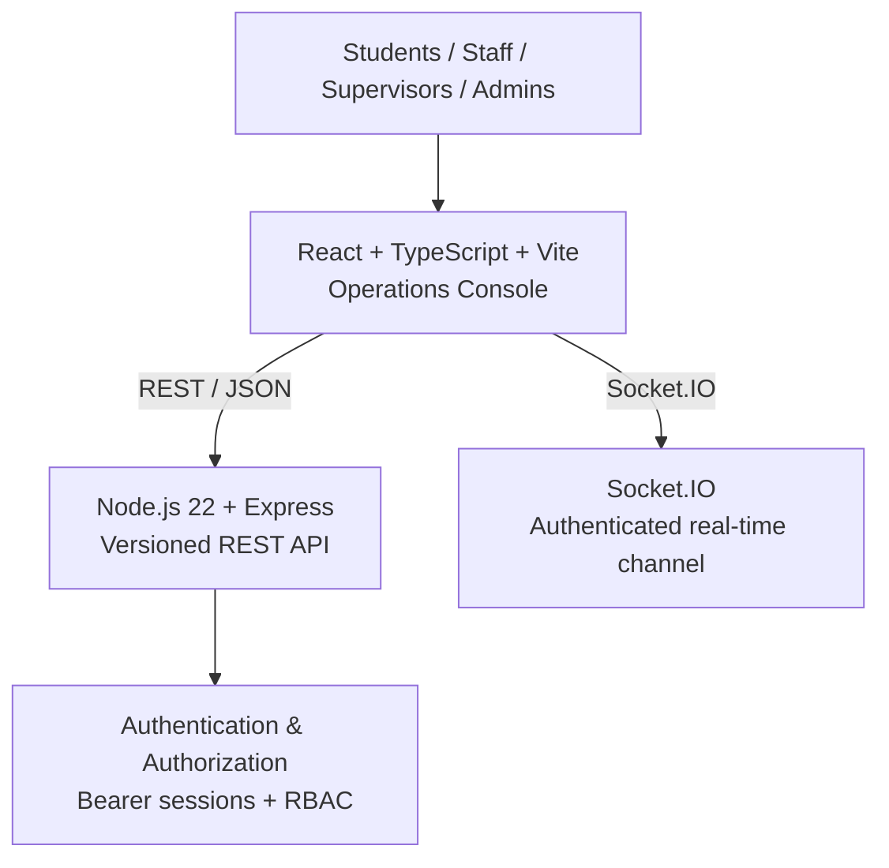
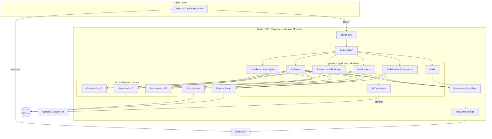
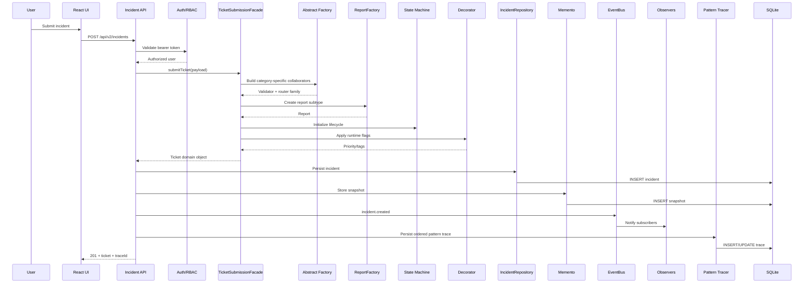
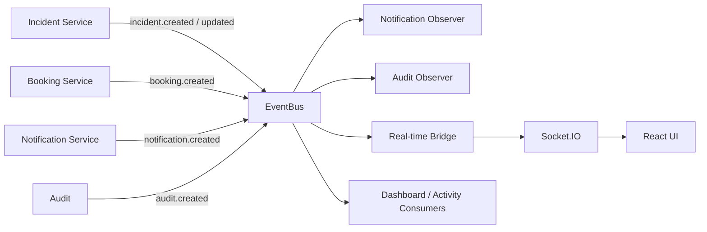
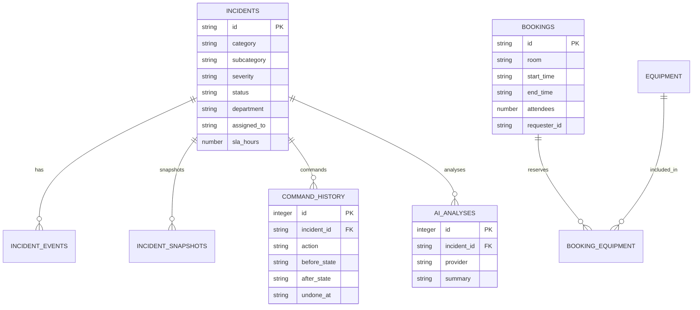
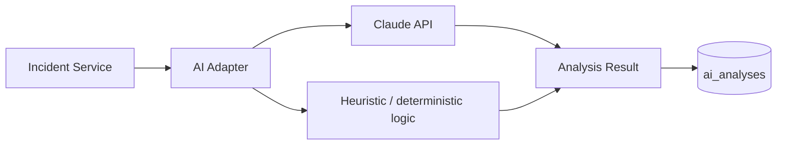

# CampusConnect V2 — Technical Architecture

## 1. Architectural Style

CampusConnect V2 is a **modular monolith**. The backend runs as one Node.js/Express process, with domain-oriented modules separated by responsibility and backed by one SQLite database.

The React + TypeScript frontend communicates with the backend through versioned REST APIs and an authenticated Socket.IO connection.

The supplied architecture/design-pattern reference describes the same high-level structure: incidents, resources/bookings, dashboard, notifications, audit, and architecture modules, with a dedicated `src/patterns/` library containing the 23 GoF patterns.

## 2. System Context



## 3. Application Architecture



The repository, EventBus, and tracer are infrastructure concerns shared by the domain modules. The pattern library remains framework-agnostic and is orchestrated by the application/domain code.

## 4. Layer Responsibilities

| Layer | Responsibility | Representative files |
|---|---|---|
| Client | UI, login, workspace views, live updates | `frontend/src/main.tsx` |
| Routes/API | HTTP endpoints, auth middleware, request/response shaping | `src/v2/routes.js`, `src/v2/auth-routes.js` |
| Domain services | Business rules and orchestration | `src/v2/incidents/service.js`, `src/v2/resources/service.js`, `src/v2/dashboard/service.js` |
| Repositories | SQLite persistence and row/domain mapping | `src/v2/incidents/repository.js`, `src/v2/resources/repository.js` |
| Pattern library | GoF pattern implementations | `src/patterns/creational/`, `structural/`, `behavioral/` |
| Infrastructure | DB, events, real-time bridge, tracing | `src/v2/infrastructure/` |
| Cross-cutting | Audit, notifications, AI adapter | `src/v2/audit.js`, `src/v2/notifications/`, `src/v2/services/` |

## 5. Incident Submission Sequence

A representative incident submission demonstrates how the patterns cooperate in a real workflow.



### Pattern path in the supplied implementation

The incident service records a trace similar to:

```text
Facade
  → Interpreter
  → Repository
  → Memento
  → Observer
```

The `TicketSubmissionFacade` itself coordinates additional GoF implementations, including Abstract Factory, Factory Method, Singleton, State, and Decorator.

## 6. Incident Lifecycle

The State pattern centralizes legal transitions. The application exposes commands such as:

```text
Submitted
   │
   ▼
Assigned
   │
   ▼
InProgress
   ├──────────────► Resolved ─────► Closed
   │
   └──────────────► PendingApproval ─► Resolved

Additional branches include rejection, send-back, reopen, escalation, and department handoff.
```

The exact command authorization is enforced server-side according to the authenticated role.

## 7. Event-Driven Flow

Domain services publish business events to the in-process EventBus rather than calling Socket.IO directly.



`realtime.js` authenticates Socket.IO connections with the same session token used by the REST API. The implementation also joins sockets to role/department rooms; current event forwarding uses the server broadcast path, so strict per-room event filtering remains a future hardening task.

## 8. Persistence Model

SQLite is created automatically at `data/campusconnect.db` by `src/v2/infrastructure/database.js`.

Important tables include:



The database also stores users, departments, campuses, buildings, floors, rooms, equipment, booking templates, notifications, audit records, and pattern traces.

## 9. Architecture Observatory

`src/v2/architecture/routes.js` exposes:

```text
GET /api/v2/architecture/patterns
GET /api/v2/architecture/traces
GET /api/v2/architecture/traces/:id
GET /api/v2/architecture/health
```

The pattern tracer records:

- operation name
- trace ID
- context
- ordered pattern/component steps
- entry and exit timestamps
- result/status
- completion timestamp

Traces are persisted to SQLite and rehydrated on startup, allowing the Observatory to retain recent execution history across restarts.

## 10. Design Pattern Map

### Creational

1. Singleton — `CampusRegistry`
2. Abstract Factory — incident family collaborators
3. Factory Method — `ReportFactory`
4. Builder — `BookingBuilder`
5. Prototype — `BookingTemplateRegistry`

### Structural

6. Adapter — `LegacyIdCardAdapter`
7. Bridge — notification type/channel separation
8. Composite — campus hierarchy
9. Decorator — dynamic incident priority flags
10. Facade — `TicketSubmissionFacade`
11. Flyweight — shared equipment metadata
12. Proxy — `SecureTicketProxy`

### Behavioral

13. Chain of Responsibility — escalation
14. Command — incident actions + undo
15. Interpreter — routing rules
16. Iterator — history/resource traversal
17. Mediator — department handoffs
18. Memento — incident snapshots
19. Observer — EventBus subscribers
20. State — incident lifecycle
21. Strategy — ticket ranking
22. Template Method — resolution workflow
23. Visitor — analytics reports

## 11. API Surface

### Authentication

```text
POST /api/v2/auth/login
GET  /api/v2/auth/me
POST /api/v2/auth/logout
GET  /api/v2/auth/demo-users
```

### Incidents

```text
POST /api/v2/incidents
GET  /api/v2/incidents
GET  /api/v2/incidents/rank
GET  /api/v2/incidents/:id
GET  /api/v2/incidents/:id/history
GET  /api/v2/incidents/:id/commands
POST /api/v2/incidents/:id/command/:action
POST /api/v2/incidents/:id/undo
POST /api/v2/incidents/:id/escalate
POST /api/v2/incidents/:id/handoff
POST /api/v2/incidents/:id/restore
POST /api/v2/incidents/:id/resolve-checklist
GET  /api/v2/incidents/:id/ai
POST /api/v2/incidents/:id/ai
GET  /api/v2/incidents/:id/ai/duplicates
GET  /api/v2/incidents/:id/ai/recommendations
```

### Resources

```text
GET  /api/v2/resources/campus
GET  /api/v2/resources/rooms
GET  /api/v2/resources/equipment
GET  /api/v2/resources/equipment-stats
GET  /api/v2/bookings
GET  /api/v2/bookings/conflicts
POST /api/v2/bookings
GET  /api/v2/staff
```

### Dashboard, Analytics, Notifications, Audit, Architecture

```text
GET /api/v2/dashboard/overview
GET /api/v2/dashboard/activity
GET /api/v2/dashboard/departments
GET /api/v2/analytics/report/:type
GET /api/v2/notifications
POST /api/v2/notifications/:id/read
POST /api/v2/notifications/read-all
GET /api/v2/audit
GET /api/v2/architecture/patterns
GET /api/v2/architecture/traces
GET /api/v2/architecture/traces/:id
GET /api/v2/architecture/health
```

## 12. Repository Strategy

Persistence is deliberately isolated behind repositories:

```text
Domain/Application Services
          │
          ▼
   Repository interface
          │
          ▼
      SQLite today
          │
          └────► PostgreSQL adapter later
```

This keeps database-specific SQL out of the main incident/resource orchestration code and provides a clear migration path if the application later requires a server-based database.

## 13. AI Architecture

AI access is provider-neutral:



Claude is optional. Duplicate detection and operational recommendations are implemented locally, while incident analysis can use the existing Claude integration when configured.

## 14. Authentication & Authorization

The authentication flow is:

```text
Login credentials
      │
      ▼
POST /api/v2/auth/login
      │
      ▼
Password verification (scrypt)
      │
      ▼
Server-side session token
      │
      ▼
Bearer token on REST requests
      │
      └────► Same token authenticates Socket.IO
```

Roles and department membership affect API visibility and permitted operations. The frontend is not trusted to choose the authenticated role.

## 15. Compatibility / Migration Architecture

The V2 system does not immediately remove the original API.

```text
                    ┌── /api/v2/* ──► V2 modular monolith
Client ─► Express ──┤
                    └── /api/* ─────► (removed — 404 JSON)
```

The legacy entry point and compatibility routes have been removed; the V2 architecture is the only runtime path.
